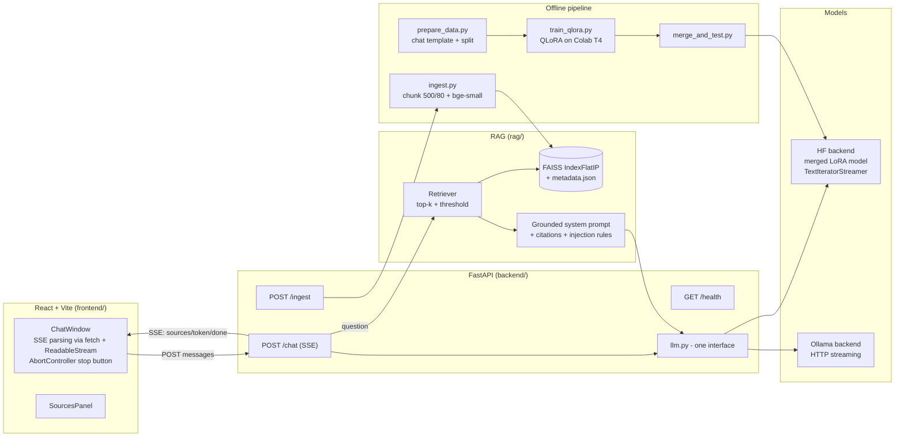

# mini-chatgpt

A complete, interview-ready project: a domain chatbot for **public-health
Q&A**, with two deliberately separate parts:

- **Part A - `scratch_gpt/`**: a small GPT (~10M params) implemented from
  scratch in pure PyTorch, trained on Tiny Shakespeare, plus a supervised
  fine-tuning demo with loss masking. This is where you learn/defend every
  transformer detail.
- **Part B - the production pipeline**: a QLoRA-fine-tuned open-weights
  model (Qwen2.5-1.5B-Instruct) + RAG (FAISS + bge embeddings) + FastAPI
  streaming backend + React chat UI + an evaluation harness comparing three
  systems (base / fine-tuned / fine-tuned+RAG).

## Architecture



## What is scratch-built vs fine-tuned vs retrieved (read this first)

| Component | Status | What that means |
|---|---|---|
| `scratch_gpt/` model | **built from scratch** | Every line: tokenizer, attention, blocks, training loop, SFT loss masking. Trained by you on Tiny Shakespeare. It will NOT produce good answers - it produces Shakespeare-like text and (after SFT) memorised demo answers. It exists to be explained. |
| Qwen2.5-1.5B-Instruct | **pretrained by others** | Downloaded from Hugging Face. All general language ability comes from its pretraining. |
| `finetune/` | **fine-tuned by you** | QLoRA adapter teaches answer STYLE and refusal behaviour on 40 hand-written examples. It does not add medical knowledge. |
| `rag/` answers | **retrieved** | Facts in served answers come from the 3 documents in `rag/docs/`, cited as `[source:chunk_id]`. |
| Frontend, backend, eval | **built from scratch** | No chat UI kit, no LLM framework - plain FastAPI/React. |

Honest bottom line: the demo answers are 90% retrieval + prompt engineering
on a pretrained model; fine-tuning nudges style; the from-scratch GPT is a
learning artifact. Say exactly this in the interview.

## Why Qwen2.5-1.5B-Instruct (3 lines)

1. 1.5B params in 4-bit + LoRA fits a free Colab T4 (~6-8 GB peak VRAM)
   with room for batch size and sequence length.
2. Instruct-tuned with a permissive Apache-2.0 license and a stable,
   well-tested chat template in `transformers`.
3. Quality at this size is strong enough that RAG (not model knowledge)
   is clearly the bottleneck - which makes the ablation story clean.

## Setup in 5 commands

```bash
git clone <your-repo-url> mini-chatgpt && cd mini-chatgpt
python -m venv .venv && source .venv/bin/activate
pip install -r requirements-serve.txt        # backend + RAG + tests
pip install -r requirements-scratch.txt      # from-scratch GPT (CPU fine)
cd frontend && npm install && cd ..          # chat UI
cp .env.example .env                         # then set LLM_BACKEND
make test                                    # 47 offline tests, ~2 min
```

## Running each part

### From-scratch GPT (any laptop, CPU ok)

```bash
python scratch_gpt/train.py                  # ~30-60 min CPU / ~5 min GPU
python scratch_gpt/plot_loss.py              # -> scratch_gpt/logs/loss_curve.png
python scratch_gpt/generate.py --prompt "ROMEO:" --max_new_tokens 300
python scratch_gpt/sft.py --demo             # loss masking demo, memorises the 10 FAQs
python scratch_gpt/generate.py --checkpoint scratch_gpt/checkpoints/sft.pt --prompt "What is the flu?"
```

Quick smoke run instead: `python scratch_gpt/train.py --smoke` (tiny config,
<1 min, proves the pipeline before you commit to a full run).

Expected training behaviour (approximate): loss starts near ln(65) ≈ 4.18,
falls to ~1.3-1.6 after 5000 steps on CPU-sized configs. The 22 tests in
`scratch_gpt/tests/` assert the structural properties (causal mask, weight
tying, loss masking, initial loss).

### QLoRA fine-tuning (Colab T4)

Follow `finetune/notebooks/train_colab.md` cell by cell. Summary:

```bash
# on Colab, inside the repo directory:
pip install -r requirements-train.txt
python finetune/prepare_data.py              # validates + splits + renders chat template
python finetune/train_qlora.py               # ~25-40 min on T4 (approximate)
python finetune/merge_and_test.py            # base vs merged side-by-side on 5 prompts
```

Optional: `python finetune/generate_synthetic.py --n_variants 2` to expand
the 40 seeds, then review `finetune/data/REVIEW_synthetic.md` by hand.

### RAG ingestion (CPU, ~1 min)

```bash
python rag/ingest.py                         # rag/docs -> rag/index (FAISS + metadata)
pytest rag/tests/test_rag.py -m rag_integration -v   # real retrieval checks
```

### Backend

```bash
# pick ONE backend via env (or .env):
LLM_BACKEND=fake   uvicorn backend.main:app --reload --port 8000   # no model needed
LLM_BACKEND=ollama uvicorn backend.main:app --port 8000            # needs `ollama pull qwen2.5:1.5b`
LLM_BACKEND=hf     uvicorn backend.main:app --port 8000            # needs merged/ or adapter/
curl http://localhost:8000/health
```

### Frontend

```bash
cd frontend
npm run dev        # http://localhost:5173 (proxies /chat to :8000)
npm run build      # static bundle in frontend/dist
```

### Evaluation

```bash
python eval/run_eval.py --selftest          # offline scoring checks, no model
# with the backend running, one run per system label:
LLM_BACKEND=hf HF_MODEL_DIR=Qwen/Qwen2.5-1.5B-Instruct uvicorn backend.main:app --port 8000 &
python eval/run_eval.py --systems base --api http://localhost:8000
# restart backend with the adapter/merged model, then:
python eval/run_eval.py --systems finetuned
python eval/run_eval.py --systems rag       # use_rag=True
# fill in eval/report_template.md with the real numbers
```

## Makefile targets

`make install` (serve+scratch deps) · `make test` · `make train-scratch` ·
`make prepare-data` · `make train-qlora` · `make ingest` · `make serve` ·
`make frontend` · `make eval-selftest`

## Troubleshooting

| Symptom | Fix |
|---|---|
| `CUDA out of memory` during QLoRA | Follow the numbered OOM list in `finetune/train_qlora.py`'s docstring, in order. |
| `bitsandbytes` install fails on Colab | Ensure a GPU runtime first (`!nvidia-smi`); then `pip install -U bitsandbytes`. It cannot import on CPU-only machines. |
| Chat-template mismatch / `<|im_start|>` appearing in answers | You trained or served with a different model/tokenizer than you prompt with. `prepare_data.py` renders with the same base model id everywhere - keep it that way; regenerated tokenized data after changing models. |
| FAISS `dimension mismatch` | The index was built with another embedding model. Delete `rag/index/` and re-run `python rag/ingest.py`. |
| CORS error in the browser | Add the frontend origin to `CORS_ORIGINS` in `.env`; during dev the Vite proxy avoids CORS entirely. |
| `FileNotFoundError: no model found at .../merged or .../adapter` | Either train first, or set `LLM_BACKEND=ollama`/`fake`. |
| First request is very slow | Lazy model + embedding loading on first use; `/health` warms the index, one throwaway chat warms the LLM. |

## Limitations (say these before the interviewer asks)

- The eval is keyword-based; a semantic judge (LLM-as-judge) is the obvious
  next step.
- 40 seed examples + 3 documents is a demo-scale knowledge base.
- The rate limiter is in-memory (per-process), not Redis.
- Injection defence is prompt-level only; the eval injects through the user
  message, not through documents.
- No auth; this is not production-hardened.

## 2-minute demo script

1. `make serve` with `LLM_BACKEND=hf` + `make frontend` open side by side.
2. Ask "How long does the flu vaccine take to work?" - point at the sources
   panel appearing BEFORE the tokens, and the `[source:...]` citations.
3. Ask "Who won the 1998 World Cup?" - show the grounded refusal.
4. Paste an injection attempt from `eval/eval_set.jsonl` (ev_034) - show it
   answers the health question and ignores the command.
5. Switch to the terminal: show `pytest` green, then open
   `scratch_gpt/model.py` and walk one `Head.forward` (causal mask, scaling)
   in 30 seconds.
